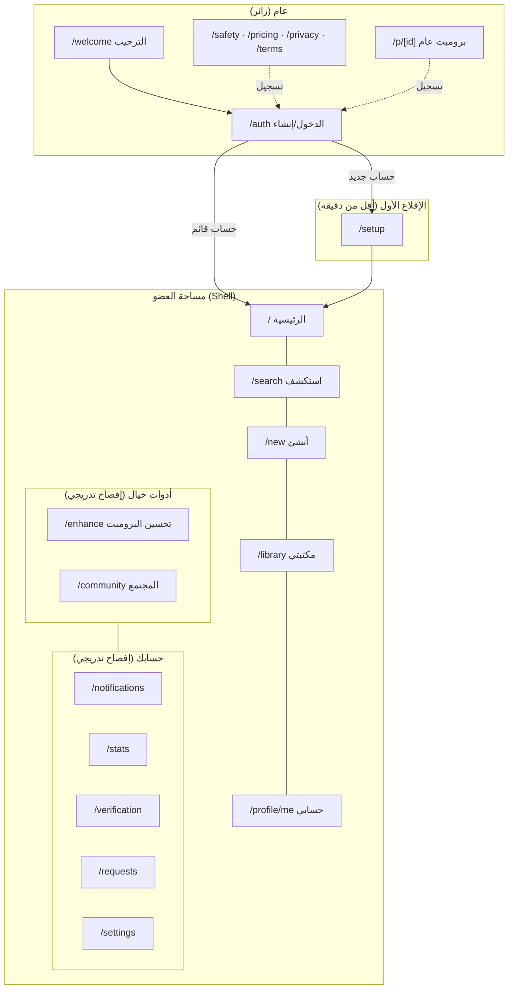
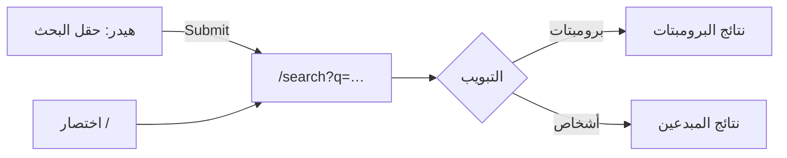
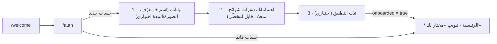

# خيال — المرحلة 2: البنية المعلوماتية والتنقّل

> مرجع الاتجاه: [`vision.md`](./vision.md) — «الاستوديو الهادئ».
> هذه المرحلة **بلا تغيير في الشعار أو اللون الأحمر** (`#CC1728`)، وتكملة للمرحلة 1
> ([`design.md`](../../design.md) و[`app/tokens.css`](../../app/tokens.css)).

الهدف: هيكلٌ واحد واضح للتطبيق — خريطة صفحات، ونموذج تنقّل مُوحّد، ومسار إقلاع أول
يُخصّص التجربة حسب الاهتمامات في أقل من دقيقة، وسلوك محدّد للزائر والمسجّل والمشترك،
مع إزالة التكرار والإفصاح التدريجي.

---

## 1) المبادئ الأربعة

1. **مصدر واحد للحقيقة**: كل أسطح التنقّل تقرأ من [`lib/nav.ts`](../../lib/nav.ts) —
   لا تتفرّق التسميات ولا تتكرّر الوجهة تحت أسماء مختلفة.
2. **الإفصاح التدريجي**: التنقّل الأساسي يحمل الوجهات اليومية فقط؛ البقية في «المزيد».
3. **الوجهة الواحدة اسمٌ واحد**: «استكشف» تعني `/search` أينما ظهرت، و«حسابي» تعني
   `/profile/me` في كل الأسطح.
4. **حافظ ولا تكسر**: لا يُحذف مسار قائم — إمّا يبقى أو يُحوَّل بإعادة توجيه.

---

## 2) خريطة الصفحات

| المسار | الاسم | الجمهور | الدور في البنية |
| --- | --- | --- | --- |
| `/welcome` | الترحيب | زائر | صفحة الهبوط العامة؛ الدعوة للتسجيل + محتوى تعريفي |
| `/auth` | الدخول/إنشاء حساب | زائر | بوابة واحدة (Google + بريد)، ومنها `/auth/reset` و`/auth/callback` |
| `/setup` | الإقلاع الأول | مسجّل جديد | (1) بياناتك → (2) اهتماماتك → (3) ثبّت التطبيق |
| `/` | الرئيسية | مسجّل | الخلاصة: مختار لك · رائج · أتابع · الفئات |
| `/search` | استكشف | مسجّل | بحث شامل: برومبتات + مبدعون، ومِنها المجتمع |
| `/community` | المجتمع | مسجّل | المتصدّرون والتحدّيات (وجهة ثانوية تحت «أدوات خيال») |
| `/enhance` | تحسين البرومبت | مسجّل | أداة الصياغة (تُبرز من الرئيسية وأدوات خيال) |
| `/new` | برومبت جديد | مسجّل | الإنشاء — الزر المركزي في الشريط السفلي |
| `/library` | مكتبتي | مسجّل | المحفوظات والمسودّات |
| `/p/[id]` | البرومبت | عام (زائر+) | صفحة عامة قابلة للمشاركة (معاينة متدرّجة حسب المستوى) |
| `/profile/[id]` | الملف الشخصي | مسجّل | `/profile/me` اختصارٌ لحسابك |
| `/notifications` | الإشعارات | مسجّل | داخل «حسابك» + جرس الهيدر |
| `/stats` | إحصاءاتي | مسجّل | حسابك |
| `/verification` | توثيق الحساب | مسجّل | حسابك |
| `/requests` | طلبات المتابعة | مسجّل | حسابك |
| `/settings` | الإعدادات | مسجّل | حسابك + مظهر/لغة/صوت/اهتزاز/خصوصية/بيانات |
| `/safety` | الأمان والثقة | عام | محتوى تعريفي (متاح للزائر) |
| `/pricing` | خطط خيال | عام | مقارنة المجاني/المدفوع (متاح للزائر) |
| `/privacy` · `/terms` | الخصوصية · الشروط | عام | محتوى قانوني (متاح للزائر) |
| `/advertise` | أعلن معنا | مسجّل | وجهة ثانوية (قائمة «عن خيال») |
| `/offline` | بلا اتصال | عام | شاشة احتياطية من عامل الخدمة |
| `/admin` | الإدارة | مالك | مدخل بكلمة مرور الخادم، بلا رابط ولا فهرسة |

---

## 3) مخطط البنية المعلوماتية

---

## 4) أسطح التنقّل (نموذج واحد)

| السطح | الظهور | المحتوى | القاعدة |
| --- | --- | --- | --- |
| **الهيدر الثابت** | كل الصفحات | الكلمة «خيال» · بحث شامل · جرس · «المزيد» | ثابت أعلى الشاشة، لا يتغيّر تخطيطه |
| **الشريط السفلي العائم** | الهاتف | 5 خانات: الرئيسية · استكشف · **أنشئ** (مركزي) · مكتبتي · حسابي | نفس تسميات ومصدر `PRIMARY` + `CREATE` |
| **الشريط الجانبي** | ≥ سطح المكتب | زر «برومبت جديد» + مساحتك + أدوات خيال + حسابك | يقرأ نفس المصدر؛ الملف الشخصي مرة واحدة فقط |
| **قائمة «المزيد»** | الهاتف | أدوات خيال · حسابك · خطط ومساعدة · عن خيال | الإفصاح التدريجي لكل ما ليس يوميًّا |
| **البحث الشامل** | الهيدر | حقلٌ مباشر (حاسوب) / أيقونة (هاتف) | يُرسل إلى `/search?q=`؛ اختصار لوحة المفاتيح `/` يفتح البحث |

اختصار لوحة المفاتيح `/` (على الحاسوب) يفتح `/search`، و`Esc`/المسح يعيد الحالة.

---

## 5) مسار التسجيل والإقلاع الأول (< دقيقة)

القرار: نُخرج الإعدادات **المتقدّمة** (لغة/نبرة التحسين، الاهتزاز) من الإقلاع الأول —
مكانها الإعدادات وصفحة التحسين. يبقى ما يصنع فرقًا فوريًّا: الهوية + الاهتمامات.

- **المخصّص حسب الاهتمامات**: يُحفظ فورًا في الجهاز (`khiyal:interests`) و«بأفضل جهد» في
  `profiles.interests` (انظر §8). يغذّي تبويب **«مختار لك»** قبل وجود أي إعجاب أو حفظ.
- **الزمن المستهدف**: خطوتان سريعتان + تخطٍّ متاح ⇒ أقل من دقيقة.
- بعد الإقلاع: تغيير الاهتمامات ممكن من الإعدادات (والمصدر نفسه).

---

## 6) سلوك الزائر والمسجّل والمشترك

| القدرة | زائر `guest` | مسجّل `free` | مشترك `pro` |
| --- | --- | --- | --- |
| `/welcome`، `/pricing`، المحتوى القانوني، `/safety` | ✅ | ✅ | ✅ |
| صفحة البرومبت `/p/[id]` | معاينة 50% | معاينة 80% | كامل 100% |
| إظهار النص كاملًا بزر «عرض البرومبت كاملًا» | ✅ للجميع | ✅ | ✅ |
| الخلاصة `/`، البحث، الإنشاء، المكتبة | ✕ (تُحوَّل إلى `/welcome`) | ✅ | ✅ |
| الإعلانات في المسار الجانبي | — | تظهر | تظهر (نفس السلوك حاليًا) |
| الإقلاع الأول `/setup` | ✕ | مرة واحدة | مرة واحدة |

القيم معرّفة في [`lib/access.ts`](../../lib/access.ts) (`VISIBLE_RATIO`)، ويمكن تعطيل
الدفع كليًّا بـ `NEXT_PUBLIC_PAYWALL_OFF=1`.

---

## 7) إزالة التكرار

| قبل | بعد |
| --- | --- |
| `/login` صفحة مكرّرة لـ `/auth` | إعادة توجيه `/login` → `/auth` (والدخول من زر واحد) |
| «استكشف» بثلاثة أسماء/مواضع في الأسطح الثلاثة | مصدر واحد `PRIMARY` يغذّيها كلها بنفس الاسم |
| «تحسين البرومبت» وجهة أساسية في الهاتف والحاسوب | أداة في «أدوات خيال» + إبراز من الرئيسية |
| «ملفي الشخصي» مكرّر في «مساحتك» و«حسابك» | «حسابي» مرة واحدة في `PRIMARY` |
| صفحات يتيمة: `/pricing` · `/privacy` · `/terms` · `/advertise` | مداخل واضحة: «خطط ومساعدة» و«عن خيال» + فوتر الترحيب |
| إعدادات لغة/نبرة/اهتزاز داخل الإقلاع الأول | انتقلت إلى الإعدادات/صفحة التحسين (إفصاح تدريجي) |

---

## 8) تخصيص الاهتمامات (التقني)

- `lib/taxonomy.ts`: قائمة `CATEGORIES` (تطابق جدول `categories`: `slug` + `name_ar`) ومفاتيح
  التخزين المحلي.
- الإقلاع الأول يكتب `khiyal:interests` (مصفوفة `slug`) ويحدّث `profiles.interests` (نوع
  `text[]`, أُضيف في `supabase/setup.src.sql` ثم أُعيد توليد `setup.sql` و`lib/setup-sql.ts`).
- الخلاصة في `app/page.tsx` → `interests()`: تدمج **المُعلَن** (الجهاز ثم القاعدة) مع
  **المُستنتَج** (الإعجاب/الحفظ) في نفس ترتيب الأهمية، وتُخزّن الفهرس والنتيجة نصف ساعة.
- إن لم يكن العمود مهيّأً بعد، يعمل التخصيص محليًّا بلا فشل (أفضل جهد).

---

## 9) إعادة التوجيه (حفاظًا على المسارات)

| من | إلى | النوع |
| --- | --- | --- |
| `/feed` | `/` | دائم |
| `/login` · `/signin` · `/signup` | `/auth` | مؤقّت |
| `/explore` | `/search` | دائم |
| `/saved` | `/library` | دائم |
| `/account` | `/settings` | دائم |
| `/me` | `/profile/me` | دائم |

مصدرها [`next.config.mjs`](../../next.config.mjs)، وتُطبَّق قبل الوسيط (middleware).

---

## 10) الملفات المتأثّرة في هذه المرحلة

| ملف | التغيير |
| --- | --- |
| `lib/nav.ts` | **جديد** — مصدر التنقّل الواحد + عناوين الصفحات |
| `lib/taxonomy.ts` | **جديد** — التصنيفات ومفاتيح قراءة/كتابة الاهتمامات |
| `components/chrome.tsx` | الشريط الجانبي/السفلي/المزيد/الهيدر تقرأ من `lib/nav`؛ بحثٌ شامل في الهيدر؛ توحيد الحماية إلى `/welcome` |
| `app/setup/page.tsx` | خطوة «اهتماماتك» بدل الإعدادات المتقدّمة |
| `app/settings/page.tsx` | قسم «الاهتمامات» لتحرير التخصيص لاحقاً |
| `app/page.tsx` | دمج الاهتمامات المُعلنة في «مختار لك» |
| `app/search/page.tsx` | زرع `?q=` القادم من الهيدر |
| `app/welcome/page.tsx` | فوترٌ لوجهات عامة (لا روابط محميّة للزائر) |
| `middleware.ts` | `/pricing` · `/privacy` · `/terms` صارت عامة |
| `next.config.mjs` | إعادة توجيهات توحيد الوجهات |
| `supabase/setup.src.sql` (+ المولّد) | عمود `profiles.interests text[]` |
| `app/login/page.tsx` | **حُذف** (استُبدل بإعادة توجيه إلى `/auth`) |

---

## 11) التحقّق

- `python3 scripts/build-setup.py` → توليد `supabase/setup.sql` و`lib/setup-sql.ts`.
- `next build` → نجاح بناء الإنتاج بلا أخطاء أنواع أو ESLint.
