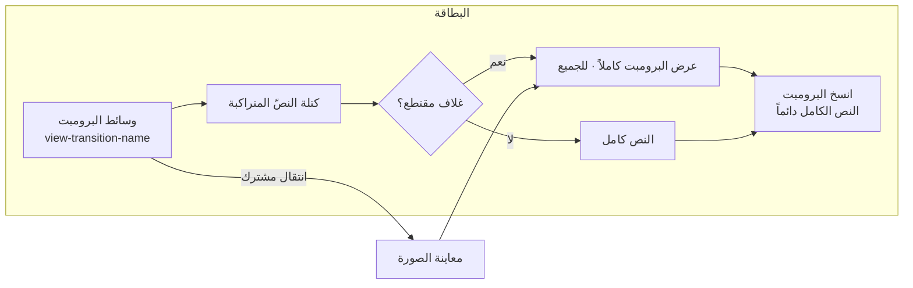
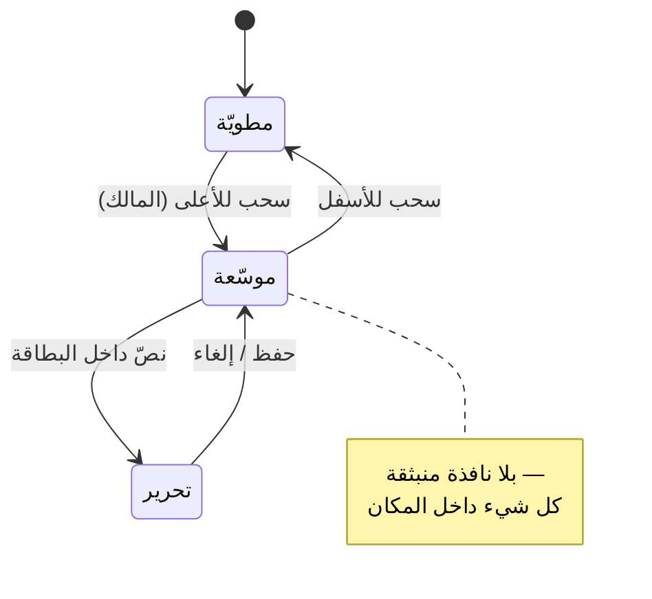

# خيال — المرحلة 3: إعادة تركيب الشاشات الأساسية

> مرجع الاتجاه: [`vision.md`](./vision.md) — «الاستوديو الهادئ».
> مرجع البنية والتنقّل: [`ia.md`](./ia.md) — المرحلة 2.
> **بلا تغيير في الشعار أو اللون الأحمر** (`#CC1728`)، وبلا نيون/توهّج/زخرفة بلا وظيفة.
> الشيفرة في نفس الالتزام: كل سطح يقرأ من [`lib/nav.ts`](../../lib/nav.ts) و
> [`lib/taxonomy.ts`](../../lib/taxonomy.ts) ولا يكرّر التسميات.

الهدف: إعادة تركيب **الشاشات الأساسية** على نظام التصميم الجديد — الرئيسية (الخلاصة
والبطاقة)، معاينة الصورة، صفحة البرومبت، الملف الشخصي، نشر البرومبت (بعنوان وتصنيف
تلقائيين)، ورشة التحسين، الاستكشاف، الإشعارات، والإعدادات.

نُفِّذت **ثلاث مقاربات تركيبية غير تقليدية** وقُورنت ثم اختير الأفضل بمبرر مكتوب:

| # | المقاربة | الفكرة | الحكم |
| --- | --- | --- | --- |
| أ | **كتل Bento** | تقسيم الرأس والشبكات إلى بلاطات بأحجام متفاوتة (كتلة ممتدّة `span-2`) | ✅ مُعتمَدة كإيقاع عام |
| ب | **الطبقات المتراصّة (Deck)** | وسائط البرومبت هي الطبقة السفلى، والنص/البيانات تتراكب فوق حافّتها | ✅ مُعتمَدة كتركيب للبطاقة والغلاف |
| ج | **الانتقالات المشتركة (Shared Transition)** | عنصر الوسائط نفسه ينتقل من البطاقة إلى المعاينة | ✅ مُعتمَدة مع تراجع آمن (CSS view-transition) |

**القرار:** تركيبٌ واحد مركّب — **«طبقات متراصّة داخل شرائط Bento»** مع **انتقال مشترك
للوسائط** بين البطاقة ومعاينتها. المبرر: الطبقات تُعطي البطاقة عمقاً وظيفياً (الوسائط
هي الموضوع، والنص يعلوها بلا حجب) بدل صندوق مسطّح؛ وBento يمنح الرئيسية والاستكشاف
إيقاعاً بصرياً يحمل «كتلة ممتدّة» واحدة تركّز العين؛ والانتقال المشترك يربط البطاقة
بمعاينتها فيصير الفتح استمراراً بصرياً لا قطعاً. كلها تُنفَّذ بـ CSS + `framer-motion`
الموجودين أصلاً، بلا إضافة اعتماد.

---

## 1) المقاربات الثلاث — لماذا اختير هذا المزيج

### أ) كتل Bento
- **ما جُرّب:** رأس الرئيسية كبلاطات (ترحيب ممتدّ + اهتمامات + أنشئ)، وشبكة الاستكشاف
  ببلاطة ممتدّة للمحتوى الأوّل.
- **المبرر:** المقاربة المسطّحة (عنوان ثم قائمة) تُسوّي كل العناصر في وزن واحد فيضيع
  المدخل. Bento يخلق **نقطة ارتكاز واحدة** (الكتلة الممتدة) ثم يتفرّع. متوافق مع
  «الاستوديو الهادئ»: التجميع بالمسافة لا بالحدود. `.bento` موجود في [`app/clean.css`](../../app/clean.css).
- **الخطر المُدار:** على الهاتف Bento قد يزدحم؛ حُصر في الصفّ الأول وبعمودين فقط.

### ب) الطبقات المتراصّة (Deck)
- **ما جُرّب:** بطاقة البرومبت بوسائط كطبقة سفلى وكتلة نصّية تتراكب على الحافّة؛ وغلاف
  الملف والأفاتار متراكبان أصلاً.
- **المبرر:** يرفع «الوسائط أولاً» (وهو ما يبحث عنه الزائر) ويُلغي الحاجة إلى إطار
  مزدوج. يجعل النص **ملتصقاً بالصورة** لا منفصلاً عنها → سياق أسرع للفهم.
- **الخطر المُدار:** التباين على الصور الفاتحة؛ الطبقة النصّية تحمل خلفية صلبة من
  `--c-snow` مع `--float` فلا تُقرأ فوق الصورة مباشرة، حفاظاً على الوضوح.

### ج) الانتقالات المشتركة بين البطاقة والمعاينة
- **ما جُرّب:** (1) `layoutId` من `framer-motion`؛ (2) `View Transitions API` عبر
  `view-transition-name`.
- **المختار: `View Transitions API`** مع تحقّق مسبق وإسقاط آمن.
- **المبرر:** `layoutId` لا يعبر البوابة (`createPortal`) في معاينة الصورة بثبات،
  ويُنتج قفزات عند تغيّر القياس. `view-transition-name` على عنصر الوسائط نفسه يعطي
  انتقالاً حقيقياً بين الحالتين، **ولا يُنتج أي خطأ بناء** ولا يحتاج اعتماداً؛ والمتصفحات
  التي لا تدعمه تنفتح المعاينة فوراً بلا حركة (إسقاط آمن). تفاصيل التنفيذ في
  [`lib/viewTransition.ts`](../../lib/viewTransition.ts).

---

## 2) الشاشة بشاشة

| الشاشة | الملف | التركيب المُعتمَد | ما تغيّر فعلياً |
| --- | --- | --- | --- |
| الرئيسية (الخلاصة) | [`app/page.tsx`](../../app/page.tsx) | Bento band + تبويبات + مجرى البطاقات | شريط Bento في الرأس (ترحيب ممتدّ · اهتماماتك · أنشئ) وربط الوسائط بالانتقال المشترك |
| البطاقة | [`components/PromptCard.tsx`](../../components/PromptCard.tsx) | طبقات: وسائط كطبقة سفلى + عنوان يعلو حافّتها | عنوان واحد متراكب على حافّة الوسائط (أُزيل تكراره من كتلة النصّ) + اسم الانتقال المشترك |
| معاينة الصورة | [`components/ImagePreview.tsx`](../../components/ImagePreview.tsx) | ورقة منزلقة بطبقة وسائط + بطاقة زجاجية عائمة | اسم انتقال مشترك للوسائط + إزالة «الكشف للجميع» المتناقض (انظر القيود) |
| صفحة البرومبت | [`app/p/[id]/page.tsx`](../../app/p/[id]/page.tsx) | طبقات: غلاف + بطاقة بيانات عائمة | بطاقة بيانات تتراكب على الغلاف |
| الملف الشخصي | [`app/profile/[id]/page.tsx`](../../app/profile/[id]/page.tsx) | للزوّار: Bento؛ للمالك: **رزمة قابلة للتوسّع بالسحب** | استبدال نافذة التعديل المنبثقة بتوسيع داخل المكان بالسحب |
| نشر البرومبت | [`app/new/page.tsx`](../../app/new/page.tsx) | صور ثم نصّ + بلاطة «توليد تلقائي» | إبراز أن العنوان/التصنيف/الوسوم تُولَّد تلقائياً |
| ورشة التحسين | [`app/enhance/page.tsx`](../../app/enhance/page.tsx) | خطوات اختر ← خصّص ← أنشئ | تأكيد خلوّها من أي نموذج/مزوّد (القيود) |
| الاستكشاف | [`app/search/page.tsx`](../../app/search/page.tsx) | Bento ببلاطة ممتدّة | أوّل نتيجة ممتدّة على الحاسوب |
| الإشعارات | [`app/notifications/page.tsx`](../../app/notifications/page.tsx) | مجموعات زمنية + تمييز غير المقروء | تجميع «اليوم/أمس/أقدم» |
| الإعدادات | [`app/settings/page.tsx`](../../app/settings/page.tsx) | قائمة ثم لوحة فرعية | بلا تغيير بنيوي (مطابقة المرحلة 2) |

---

## 3) القيود وكيف حُفظت

| القيد | التنفيذ | التحقّق |
| --- | --- | --- |
| **إخفاء جزء من البرومبت للجميع مع إتاحة النسخ** | الغلاف المقتطع يأتي من الخادم (`prompts_gated`/`prompt_gated`) بحسب المستوى: زائر 50٪ · مجاني 80٪ · مشترك/مالك 100٪؛ ويبقى زر «انسخ البرومبت» متاحاً دائماً | [`lib/access.ts`](../../lib/access.ts) + [`supabase/setup.src.sql`](../../supabase/setup.src.sql) (الدالتان `prompts_gated`/`prompt_gated`) + [`components/PromptCard.tsx`](../../components/PromptCard.tsx) — **لم تُلمَس دلالات البوابة** |
| **توسعة المالك لبطاقته بالسحب بلا نافذة منبثقة** | منشورات المالك في ملفه صارت **بطاقة قابلة للتوسّع بالسحب للأعلى** (اكتشاف داخل المكان)، والتحرير يتم داخل البطاقة نفسها — أُزيلت نافذة التعديل المنبثقة | [`components/OwnerPromptCard.tsx`](../../components/OwnerPromptCard.tsx) |
| **تعديل/حذف البرومبت من الملف الشخصي فقط** | البطاقة في الرئيسية بلا أفعال مالك؛ أفعال التحرير/الحذف محصورة في بطاقة المالك بالملف الشخصي | [`components/PromptCard.tsx`](../../components/PromptCard.tsx) (تعليق صريح) |
| **لا نموذج ولا مزوّد في واجهة التحسين** | لا يظهر أي اسم نموذج/مزوّد/مفتاح؛ الرسائل عربية وظيفية فقط | [`app/enhance/page.tsx`](../../app/enhance/page.tsx) |
| **بلا نيون/توهّج/زخرفة** | لم يُضَف أي تدرّج إشعاعي أو نبض؛ الحركة إمّا وظيفية أو مُطفأة عند `prefers-reduced-motion` | [`app/clean.css`](../../app/clean.css) |

---

## 4) خريطة التدفّق (Mermaid)

